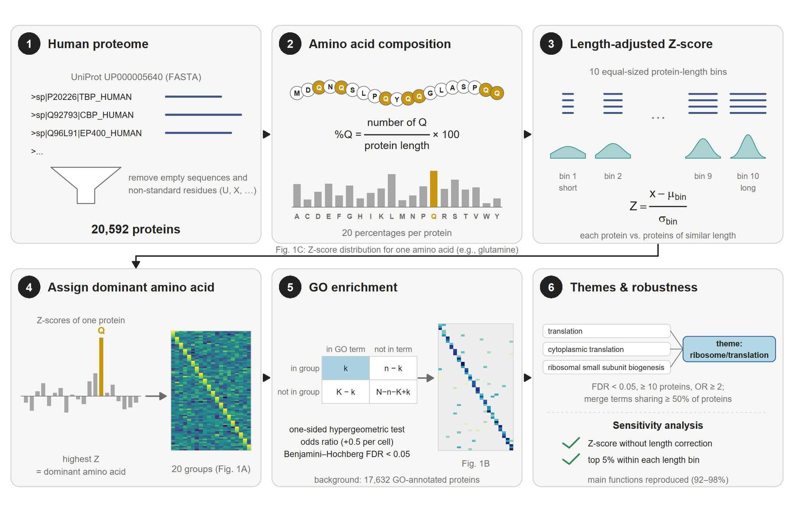

# Amino acid composition and function across the human proteome

Code and data to reproduce Figure 1 (and Table S2) of
*[manuscript title — to be added]*.

Every human protein is assigned to the amino acid it is most enriched in,
relative to proteins of similar length. Each of the 20 resulting groups is then
tested for over-represented GO Biological Process terms.



## Quick start

Requirements: R ≥ 4.5 (tested with 4.5.3). Python is needed only to rebuild
`data/` from the raw UniProt FASTA.

```bash
git clone https://github.com/vetmohit89/aa-composition-proteome.git
cd aa-composition-proteome
Rscript install_packages.R      # once
Rscript run_all.R               # about 1-2 minutes
```

All figures and tables are written to `results/`. A copy of every output is
already committed, so you can browse the results without running anything.

## Pipeline

| Step | Script | What it does | Output |
|---|---|---|---|
| 1 | `scripts/01_aa_composition_zscores.py` | Percentage of each of the 20 amino acids per protein; proteome-wide Z-scores | `data/human_aa_percentages.tsv`, `data/human_aa_zscores.tsv` |
| 2 | `scripts/02_length_adjusted_zscores.R` | Z-scores within 10 protein-length bins (removes the short-protein bias) | `data/human_aa_zscores_length_adjusted.tsv` |
| 3 | `scripts/03_figure1A_heatmap.R` | Assigns each protein to its dominant amino acid (highest Z); proteome heatmap | `results/Fig1A/` |
| 4 | `scripts/04_figure1B_GO_enrichment.R` | Hypergeometric GO enrichment per group, global BH-FDR, heatmap, representative themes | `results/Fig1B_GO/` (Table S2) |
| 5 | `scripts/05_figure1C_distribution.R` | Distribution of one amino acid's Z-scores with labelled genes | `results/Fig1C/` |
| 6 | `scripts/06_sensitivity_compare.R` | Repeats the GO analysis with alternative group definitions and compares | `results/Sensitivity/` |
| 7 | `scripts/07_methods_schematic.R` | Workflow cartoon | `results/Methods_schematic/` |

`run_all.R` runs steps 2-7. Full methods are in [docs/METHODS.md](docs/METHODS.md).

### Key outputs

- `results/Fig1B_GO/TableS2_Fig1B_source_data.xlsx` contains all statistics:
  - `Heatmap matrix`: source data for Figure 1B
  - `Associations`: 1,255 significant amino acid–GO pairs, with OR 95% CI and genes
  - `Representative themes` and `Top themes`: main functions per amino acid
  - `All tests`: all 5,933 tests
  - `Parameters`: settings and annotation versions
- Open the `.xlsx` rather than the CSVs in Excel. Excel can read very small P values in a CSV as text, and a number filter then silently drops them.

## Rebuilding `data/` from UniProt (optional)

`data/` holds the tables used in the manuscript. They were computed from the
UniProt human reference proteome UP000005640 (one protein sequence per gene, Swiss-Prot plus TrEMBL; downloaded 2026-10-14).
To recompute them:

```bash
pip install -r requirements.txt
curl -O https://ftp.uniprot.org/pub/databases/uniprot/current_release/knowledgebase/reference_proteomes/Eukaryota/UP000005640/UP000005640_9606.fasta.gz
gunzip UP000005640_9606.fasta.gz
python scripts/01_aa_composition_zscores.py UP000005640_9606.fasta --output-prefix data/human
Rscript run_all.R
```

UniProt is updated regularly, so a newer download will give slightly different
protein counts and statistics than those in the manuscript.

## Analysing another amino acid or proteome

- **Figure 1C for another amino acid or other genes:** edit `aa_focus`,
  `aa_label` and `label_genes` at the top of `scripts/05_figure1C_distribution.R`.
- **Other enrichment settings:** term-size limits, minimum overlap, FDR cutoff,
  and theme criteria are set in the "Settings" block of
  `scripts/04_figure1B_GO_enrichment.R`.
- **Another species:** run step 1 on that proteome's FASTA and replace
  `org.Hs.eg.db` with the matching Bioconductor annotation package.

## Software

R 4.5.3 with ComplexHeatmap, circlize, ggplot2, ggrepel, patchwork,
RColorBrewer, readxl, writexl, and Bioconductor AnnotationDbi, org.Hs.eg.db
3.22.0, and GO.db 3.22.0 (GO release 2025-07-22). Python 3 with Biopython. Exact
session details are in `results/Fig1B_GO/sessionInfo.txt`.

## Citation and license

Citation and license will be added on publication.
